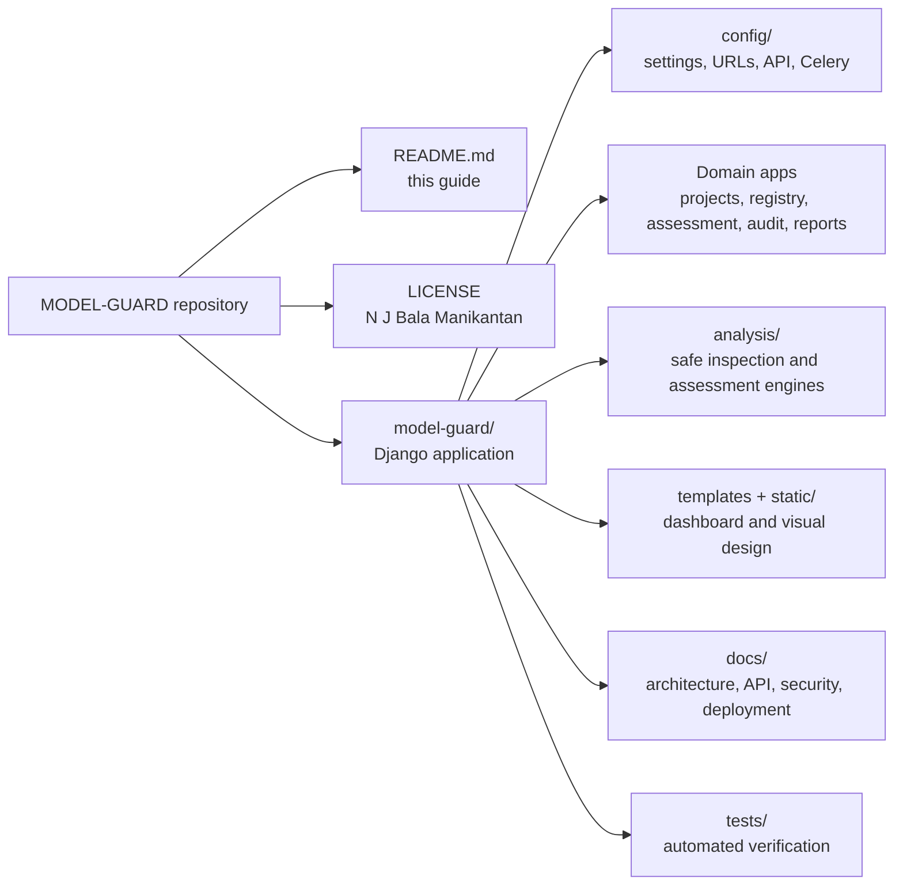
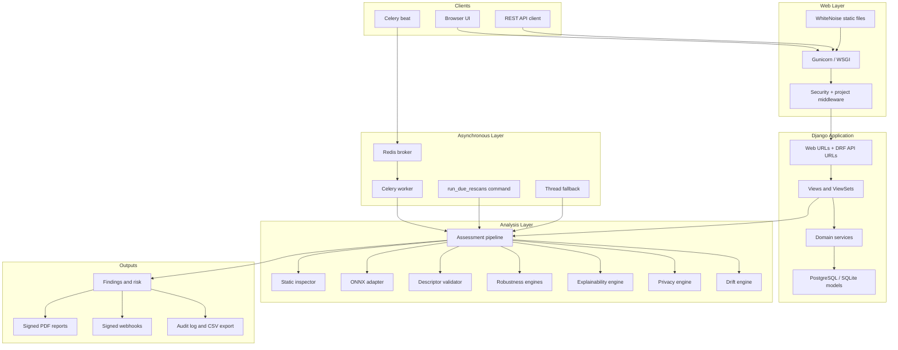
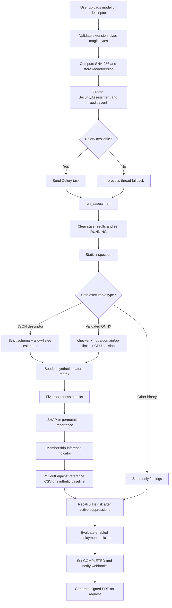
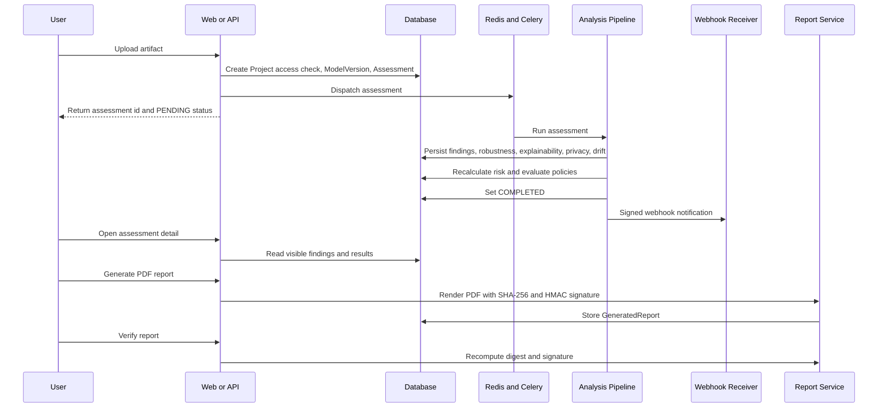
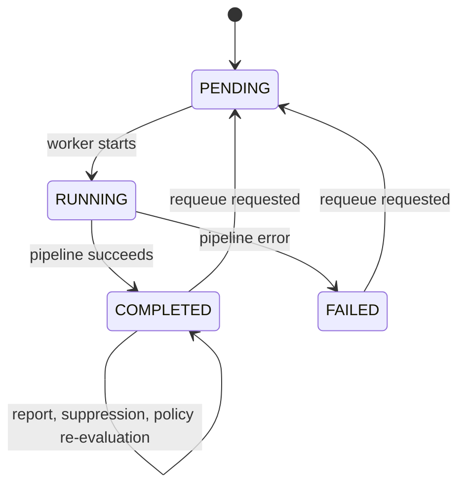
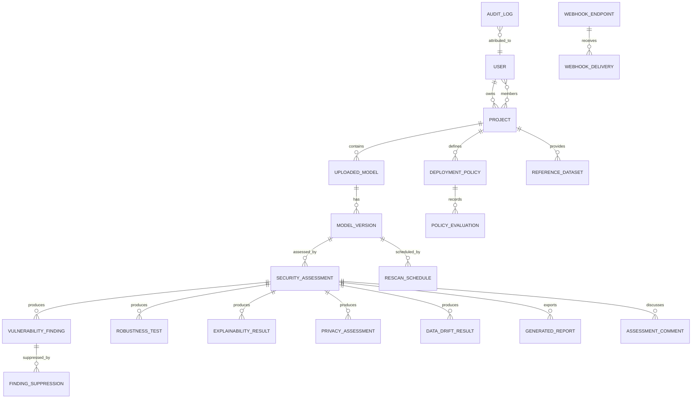

# ModelGuard

ModelGuard is a production-oriented Django application for assessing machine learning model artifacts. It treats uploaded files as hostile data, performs static-only inspection by default, and enables executable demonstrations only for validated JSON descriptors or structurally validated ONNX graphs.

The complete Django application lives in this `model-guard/` folder.

---

## 1. Repository Map



---

## 2. What ModelGuard Does

| Area | Capability | Outcome |
| --- | --- | --- |
| Ingestion | Extension allow-list, size limits, magic-byte checks, SHA-256 hashing | Artifacts are identified and tracked without blind loading |
| Static inspection | Unsafe serialization tokens, archive entries, ONNX signature checks | Risky binary formats are flagged but never deserialized |
| Safe execution | Strict JSON descriptors and hardened CPU-only ONNX adapter | Controlled robustness, explainability, privacy and drift tests |
| Robustness | FGSM, PGD, L2_PGD, GAUSSIAN, PATCH | Five repeatable attack demonstrations |
| Explainability | SHAP or permutation importance with PNG plot | Feature influence evidence for every executable assessment |
| Privacy | Experimental train-versus-holdout confidence gap | Decision-support privacy indicator, not certification |
| Drift | Population Stability Index against CSV reference data | Per-feature distribution shift detection |
| Governance | Suppressions, comments, policies, scheduled rescans | Reviewer workflow with administrator controls and audit events |
| Reporting | SHA-256 and HMAC-signed PDF with verification page | Tamper-evident assessment export |
| Integration | Token API, signed webhooks, CSV audit export | Machine-readable and enterprise-friendly workflows |
| UI | Glassmorphism dashboard, Chart.js, Three.js, GSAP | Premium responsive operator experience |

---

## 3. High-Level Architecture



---

## 4. Model Assessment Flow



---

## 5. Assessment Sequence



---

## 6. Assessment Lifecycle



---

## 7. Data Model Overview



---

## 8. Folder Structure

```text
MODEL-GUARD/
├── README.md
├── LICENSE
└── model-guard/
    ├── manage.py
    ├── requirements.txt
    ├── Dockerfile
    ├── docker-compose.yml
    ├── .env.example
    ├── .gitignore
    ├── .dockerignore
    ├── config/
    │   ├── settings.py
    │   ├── urls.py
    │   ├── api_urls.py
    │   ├── api_views.py
    │   ├── viewsets.py
    │   ├── serializers.py
    │   ├── celery.py
    │   ├── middleware.py
    │   ├── wsgi.py
    │   └── asgi.py
    ├── accounts/
    ├── projects/
    ├── modelregistry/
    ├── assessments/
    ├── robustness/
    ├── explainability/
    ├── privacy/
    ├── reports/
    ├── audit/
    ├── dashboard/
    ├── docs/
    ├── analysis/
    │   ├── onnx_adapter.py
    │   ├── descriptor.py
    │   ├── static_inspection.py
    │   ├── robustness_engine.py
    │   ├── explainability_engine.py
    │   ├── privacy_engine.py
    │   ├── drift_engine.py
    │   ├── diff_engine.py
    │   ├── reference.py
    │   ├── plotting.py
    │   ├── pipeline.py
    │   └── tasks.py
    ├── templates/
    │   ├── base.html
    │   ├── dashboard/
    │   ├── projects/
    │   ├── modelregistry/
    │   ├── assessments/
    │   ├── reports/
    │   ├── audit/
    │   └── docs/
    ├── static/
    │   ├── css/main.css
    │   ├── js/app.js
    │   └── vendor/
    ├── samples/
    ├── tests/
    └── docs/
        ├── API.md
        ├── ARCHITECTURE.md
        ├── DATABASE.md
        ├── SECURITY.md
        └── DEPLOYMENT.md
```

---

## 9. Technology Stack

| Layer | Technology | Purpose |
| --- | --- | --- |
| Backend | Python 3.12, Django 6.1 | Web framework and ORM |
| API | Django REST Framework, Token auth | REST resources and upload endpoint |
| Database | PostgreSQL, SQLite fallback | Production storage and offline testing |
| Async | Celery, Redis, thread fallback | Assessment dispatch and scheduled rescans |
| Static files | WhiteNoise, Gunicorn | Production serving |
| Analysis | NumPy, pandas, SciPy, scikit-learn | Safe generated data and model demonstrations |
| ONNX | onnx, onnxruntime | Validated CPU-only graph execution |
| Explanations | SHAP, Matplotlib, Pillow | Feature importance and PNG plots |
| Reporting | ReportLab, hashlib, hmac | Signed PDF generation and verification |
| Frontend | Three.js, GSAP, Chart.js | Neural graph, transitions and charts |
| Tests | Django `TestCase` | Workflow, security and feature verification |

---

## 10. Install and Run Locally

Run these commands from the repository root:

```bash
cd model-guard
python -m venv .venv
```

Windows PowerShell:

```powershell
.venv\Scripts\activate
pip install -r requirements.txt
copy .env.example .env
python manage.py migrate
python manage.py createsuperuser
python manage.py runserver
```

macOS or Linux:

```bash
source .venv/bin/activate
pip install -r requirements.txt
cp .env.example .env
python manage.py migrate
python manage.py createsuperuser
python manage.py runserver
```

Open `http://127.0.0.1:8000/`.

The example environment uses SQLite. For PostgreSQL, set `DB_ENGINE=django.db.backends.postgresql` and the matching `DB_*` values, or provide `DATABASE_URL`.

---

## 11. Docker Deployment

```bash
cd model-guard
copy .env.example .env
docker compose up --build -d
docker compose exec web python manage.py createsuperuser
```

macOS or Linux equivalent:

```bash
cd model-guard
cp .env.example .env
docker compose up --build -d
docker compose exec web python manage.py createsuperuser
```

The compose stack starts:

| Service | Purpose |
| --- | --- |
| `db` | PostgreSQL 16 with persistent volume |
| `redis` | Celery broker and result backend |
| `web` | Gunicorn application server and static collection |
| `worker` | Celery assessment worker |
| `beat` | Celery beat scheduler for rescans |

Production settings should set `MG_DEBUG=false`, strong `MG_SECRET_KEY` and `MG_REPORT_SIGNING_KEY`, real allowed hosts, secure cookies and HTTPS redirect/HSTS values.

---

## 12. Production Commands Without Docker

```bash
pip install -r requirements.txt
python manage.py migrate --noinput
python manage.py collectstatic --noinput
celery -A config worker --loglevel=info
celery -A config beat --loglevel=info
gunicorn config.wsgi:application --bind 0.0.0.0:8000 --workers 3 --timeout 120
```

One-shot rescan scheduling:

```bash
python manage.py run_due_rescans
```

---

## 13. Environment Variables

| Variable | Default | Purpose |
| --- | --- | --- |
| `MG_SECRET_KEY` | development placeholder | Django secret key; must be strong in production |
| `MG_DEBUG` | `true` | Debug mode; set `false` in production |
| `MG_ALLOWED_HOSTS` | localhost values | Comma-separated allowed hosts |
| `DB_ENGINE` | PostgreSQL | Django database backend; SQLite supported locally |
| `DATABASE_URL` | unset | Alternative to individual `DB_*` settings |
| `MG_MAX_UPLOAD_BYTES` | `209715200` | Maximum artifact size |
| `MG_SAMPLE_ROWS` | `400` | Rows used for generated analysis data |
| `MG_ENABLE_SHAP` | `true` | Enable SHAP explanations where available |
| `MG_ENABLE_ART` | `false` | Optional Adversarial Robustness Toolbox flag |
| `MG_ENABLE_ONNX` | `true` | Enable validated ONNX execution |
| `MG_ONNX_MAX_NODES` | `1000` | Maximum accepted ONNX graph nodes |
| `MG_ONNX_ALLOWED_DOMAINS` | `,ai.onnx` | Allowed ONNX domains; empty entry means standard domain |
| `MG_FGSM_EPSILON` | `0.12` | FGSM attack strength |
| `MG_PGD_EPSILON` | `0.12` | PGD attack strength |
| `MG_PGD_STEPS` | `8` | PGD iteration count |
| `MG_PGD_STEP_SIZE` | `0.03` | PGD step size |
| `MG_PATCH_FEATURES` | `1` | Features changed by patch attack |
| `MG_GAUSSIAN_SIGMA` | `0.15` | Gaussian noise standard deviation |
| `MG_PRIVACY_GAP_THRESHOLD` | `0.15` | Privacy indicator threshold |
| `MG_DRIFT_PSI_THRESHOLD` | `0.2` | Drift threshold |
| `MG_DRIFT_WATCH_THRESHOLD` | `0.1` | Watch threshold |
| `MG_RESCAN_MIN_INTERVAL_MINUTES` | `15` | Minimum rescan interval |
| `MG_REPORT_SIGNING_KEY` | falls back to `MG_SECRET_KEY` | HMAC key for signed PDFs |
| `MG_WEBHOOK_TIMEOUT` | `3.0` | Outbound webhook timeout |
| `MG_WEBHOOK_MAX_BYTES` | `1048576` | Maximum webhook response size |
| `MG_ALLOW_PRIVATE_WEBHOOKS` | `false` | Allow private-network webhook targets |
| `MG_API_RATE_LIMIT` | `1000/hour` | DRF user throttle rate |
| `MG_LOG_LEVEL` | `INFO` | Application log level |

---

## 14. API Reference Summary

| Endpoint | Purpose |
| --- | --- |
| `/api/auth/token/` | Obtain token |
| `/api/me/` | Current user |
| `/api/projects/` | Projects |
| `/api/models/` | Uploaded models |
| `/api/versions/` | Model versions and hashes |
| `/api/upload/` | Upload artifact and create assessment |
| `/api/assessments/` | Assessments |
| `/api/assessments/{id}/queue/` | Re-queue an assessment |
| `/api/findings/` | Vulnerability findings |
| `/api/suppressions/` | Suppressions with approve/revoke actions |
| `/api/comments/` | Assessment comments |
| `/api/schedules/` | Rescan schedules |
| `/api/robustness/` | Five attack results |
| `/api/explainability/` | Importance values and plot image |
| `/api/privacy/` | Privacy indicators |
| `/api/reference-datasets/` | CSV drift baselines |
| `/api/drift/` | Per-feature PSI results |
| `/api/policies/` | Deployment policies with evaluate action |
| `/api/policy-evaluations/` | Recorded policy decisions |
| `/api/reports/` | Signed report metadata |
| `/api/audit/` | Audit events |
| `/api/webhooks/` | Administrator-managed webhook endpoints |
| `/api/webhook-deliveries/` | Webhook delivery log |
| `/api/dashboard/summary/` | Aggregate posture |
| `/api/schema/` | OpenAPI schema |

Token example:

```bash
curl -X POST http://localhost:8000/api/auth/token/ \
  -d "username=admin&password=your-password"
```

Upload example:

```bash
curl -X POST http://localhost:8000/api/upload/ \
  -H "Authorization: Token <token>" \
  -F "project_id=1" \
  -F "model_name=fraud-detector" \
  -F "version_label=v1" \
  -F "file=@samples/synthetic_model.json"
```

---

## 15. Descriptor Format

```json
{
  "schema": "modelguard.descriptor.v1",
  "model_type": "logistic_regression",
  "features": ["latency_ms", "packet_size", "error_rate", "request_volume"],
  "parameters": {"C": 1.0, "max_iter": 300},
  "seed": 42
}
```

| Supported model type | Engine |
| --- | --- |
| `logistic_regression` | Allow-listed scikit-learn estimator |
| `decision_tree` | Allow-listed scikit-learn estimator |
| `random_forest` | Allow-listed scikit-learn estimator |
| `gradient_boosting` | Allow-listed scikit-learn estimator |
| ONNX graph | Hardened CPU-only ONNX Runtime adapter |

Only parameters declared in `analysis/descriptor.py` are accepted. Unknown descriptor keys are rejected.

---

## 16. Test and Verification Commands

Windows PowerShell:

```powershell
$env:DB_ENGINE='django.db.backends.sqlite3'
$env:DB_NAME='db.sqlite3'
python manage.py check
python manage.py makemigrations --check --dry-run
python manage.py test tests -v 2
python manage.py collectstatic --noinput
```

macOS or Linux:

```bash
export DB_ENGINE=django.db.backends.sqlite3
export DB_NAME=db.sqlite3
python manage.py check
python manage.py makemigrations --check --dry-run
python manage.py test tests -v 2
python manage.py collectstatic --noinput
```

Production deployment check:

```bash
python manage.py check --deploy
```

The automated suite verifies workflow security, descriptor validation, static inspection, ONNX handling, five robustness attacks, drift, suppression approval/revocation, policies, signed reports, signed webhooks, rescan scheduling, API scoping and frontend page rendering.

---

## 17. Security Model

| Rule | Implementation |
| --- | --- |
| No blind deserialization | No `pickle.load`, `joblib.load` or `torch.load` on uploads |
| Validated execution only | Strict descriptors or structurally validated ONNX graphs |
| Hardened ONNX | Protobuf signature, checker, node/domain/op limits, no external data, CPU-only session |
| Project scoping | Every queryset is scoped to accessible projects |
| Role separation | Viewer cannot write; admin-only suppression approval and webhook management |
| Signed reports | SHA-256 digest plus HMAC-SHA256 signature |
| Signed webhooks | HMAC-SHA256 signature header and recorded deliveries |
| Auditability | Uploads, assessments, approvals, policy decisions and rescans are logged |

Absence of findings is not proof of security. Robustness, explainability, privacy and drift outputs are controlled demonstrations and decision support, not certification.

---

## 18. Documentation

| File | Contents |
| --- | --- |
| `docs/ARCHITECTURE.md` | Layered architecture and request flow |
| `docs/DATABASE.md` | Models, indexes and data lifecycle |
| `docs/API.md` | Endpoint and authorization reference |
| `docs/SECURITY.md` | Threat model and safety controls |
| `docs/DEPLOYMENT.md` | Local, Docker and production operations |

---

## 19. License and Author

MIT License.

Author and copyright holder: **N J Bala Manikantan**.
